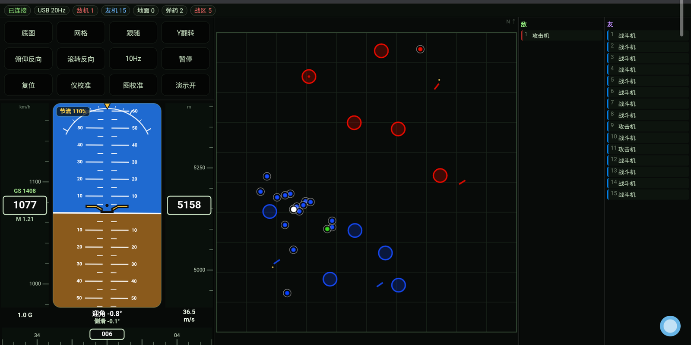
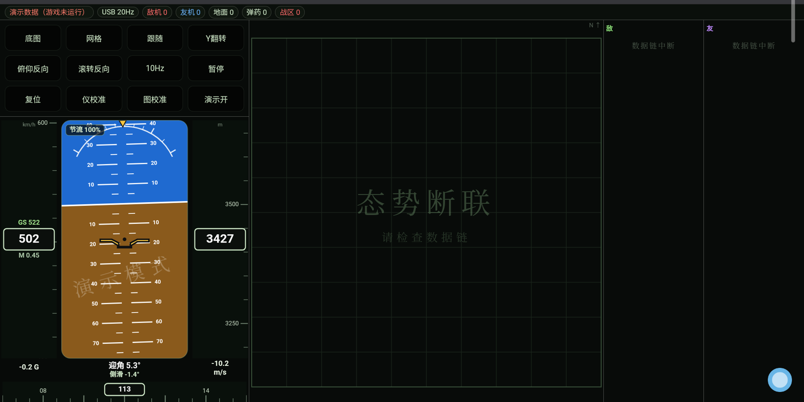
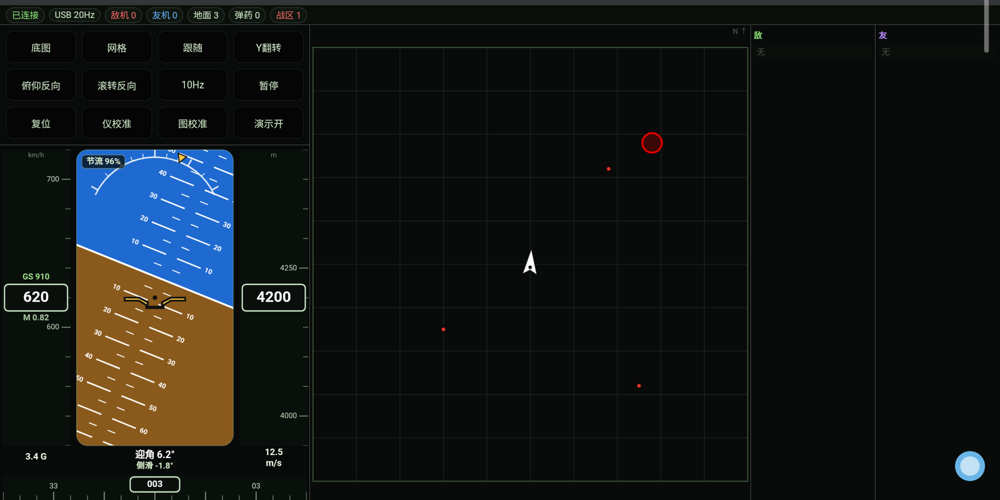
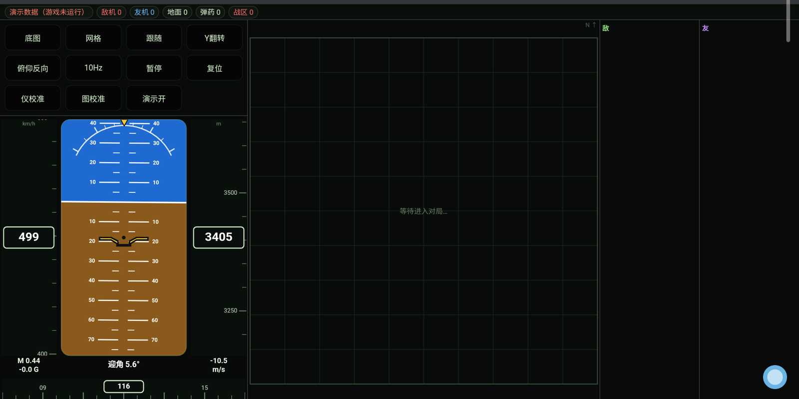

<div align="center">

# WT Tactical Map

**A second-screen tactical map & flight instrument panel for War Thunder — running in any tablet browser.**

[](LICENSE)


</div>

> ### ⚠️ AI-generated project
> **This project is 100% AI-generated.**
> All code, scripts and documentation were produced by the **DeepSeek V4 Flash** model.
> The human contributor only described requirements, reported behaviour and verified results.

---

## What it is

War Thunder exposes a local HTTP API on `127.0.0.1:8111` while running.
This project consumes that API and renders it as a **second screen on a tablet**:

- **Tactical map** — terrain, air/ground contacts, capture zones, ammo points, kill feed
- **Flight instruments** — attitude indicator, indicated airspeed, altitude, Mach, heading, G-load, AoA, sideslip, throttle

No memory reading, no injection, no file modification, no automation.

## Screenshots

| Dashboard | Offline state |
|---|---|
|  |  |

| Self arrow | Demo mode |
|---|---|
|  |  |

## Why a proxy is needed

The game binds its API to `127.0.0.1` only, so a tablet on the LAN cannot reach it.
A ~200-line Node script listens on `0.0.0.0:8112`, forwards `/api/*` to the game and serves the single-page frontend.

```
Game (aces.exe)             Node relay              Tablet
127.0.0.1:8111   ───────▶   0.0.0.0:8112   ───────▶  browser
                            reverse proxy + static
```

## Requirements

| Item | Requirement |
|---|---|
| OS | Windows 10 / 11 |
| Runtime | **Node.js ≥ 18** (only dependency, no npm packages) |
| Browser | Any modern browser with Canvas 2D |
| Game | War Thunder running **and in a match** |
| Optional | `adb` (platform-tools) for the USB high-refresh mode |

## Quick start

1. Install Node.js 18+ from <https://nodejs.org/>
2. Unzip this repository anywhere
3. Run `scripts\start.cmd`
4. Open the printed `http://192.168.x.x:8112/` on your tablet

The page also works without the game — it falls back to a clearly-watermarked demo mode.

## Two transport modes

| Mode | Tablet URL | Link | Instrument rate |
|---|---|---|---|
| LAN | `http://<PC-IP>:8112/` | Wi-Fi | 10 Hz |
| USB | `http://127.0.0.1:8112/` | USB cable via `adb reverse` | 20 Hz |

The page detects which one you used and shows it in the top bar (`USB 20Hz` / `WiFi 10Hz`).

For USB mode:

```bat
adb reverse tcp:8112 tcp:8112
```

## How the attitude indicator works

It is a **repeater**, not a sensor.

The game already computes attitude; `/indicators` returns `aviahorizon_pitch`, `aviahorizon_roll` and `compass` as plain degrees.
The frontend renders them every frame:

- horizon translated by pitch, rotated by roll
- pitch ladder every 5°, labels every 10°, range ±60° (drawn to ±85°)
- roll arc fixed at the top, pointer rotates with roll
- fixed aircraft symbol that never moves

Because data arrives at 10–20 Hz while the screen runs at 60 fps, values go through a first-order exponential filter (τ = 35 ms) so needles move continuously instead of stepping.

## Project layout

```
├─ src/server.js        relay (Node built-ins only)
├─ src/index.html       entire frontend (no build step, no framework)
├─ scripts/             start / stop / supervisor / watchdog / firewall
├─ docs/                technical docs (Chinese)
├─ screenshots/
└─ WT-Map-Whitepaper.pdf
```

The interface and documentation are written in Chinese; the code is self-explanatory.

## Legal / fair play

This tool only displays information the game's own minimap and chat already show.
It deliberately does **not** implement enemy distance/speed calculation, unspotted targets, or automation.

Please confirm your game mode and any tournament rules allow it. Open source does not mean risk-free.

## License

[MIT](LICENSE)

## Credits

- Data interface provided by the game client itself; this project only reads it.
- Everything here was generated by **DeepSeek V4 Flash**.

## Attitude estimation for newer aircraft

Since game version 2.59.0, some newer aircraft no longer expose `aviahorizon_pitch` / `aviahorizon_roll`.
This project falls back to an estimation mode (`EST`):

- pitch = flight-path angle (`asin(Vy/TAS)`) + AoA
- bank = `atan(TAS × heading-rate / g)` over a ~1.5 s window

The estimated attitude is drawn **without sky/ground colours**, with a green `EST` badge.
Bank is not trustworthy, so no bank pointer is shown — only a "roll left / roll right" cue.

> Credit: the estimation approach is based on
> [WarThunder-8111-HUD](https://github.com/A-common-Chinese/WarThunder-8111-HUD) by **缩写ACC**.
> Thanks for open-sourcing it and explaining the method.