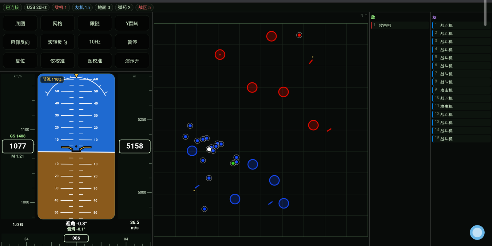
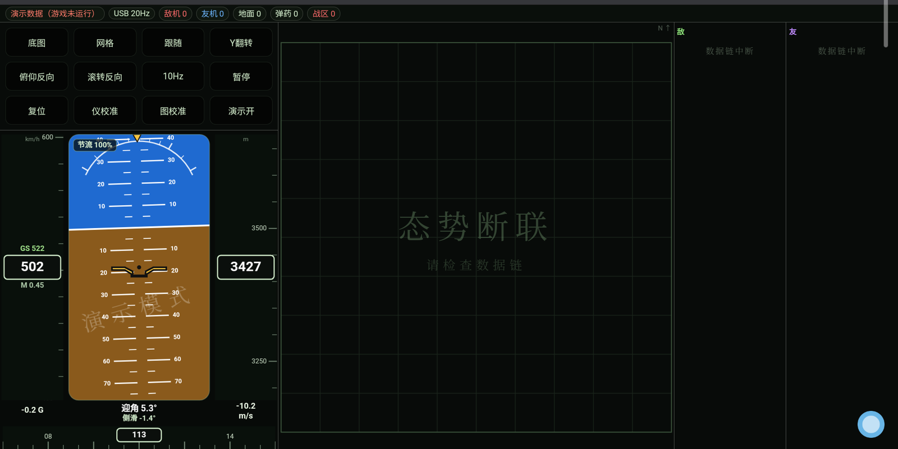
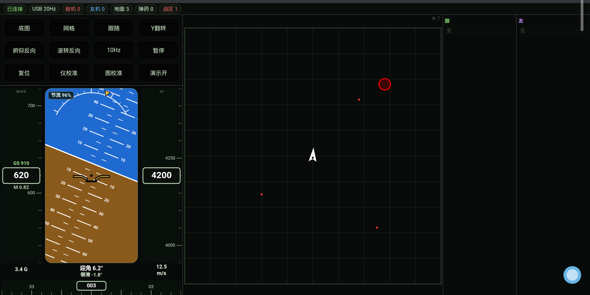
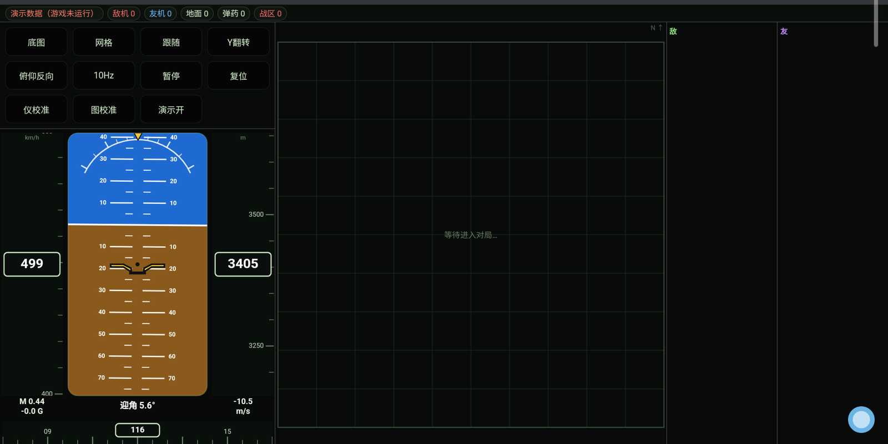

# WT 战术地图（WT Tactical Map）

把《战争雷霆》自带的本地数据接口（`127.0.0.1:8111`）做成一块**平板上的战术地图 + 飞行仪表盘**。

地图显示敌我单位、战区、占点、弹药与击落播报；左侧是一套波音风格的姿态仪（地平仪、表速/高度带、航向带、节流阀、过载、迎角、侧滑）。

> ### ⚠️ 生成声明
> **本项目是一个 100% 由 AI 生成的项目。**
> 全部代码、脚本与技术文档均由 **DeepSeek V4 Flash** 模型生成，
> 人类作者仅提出需求、描述现象、验证效果。
> 仓库中不存在人工手写的业务代码。

---

> **第一次用？** 直接看 [开始使用.txt](开始使用.txt) —— 零基础、五步、带常见问题。

## 效果预览

| 主界面（真实对局数据） | 断联状态 |
|---|---|
|  |  |

| 自身箭头（机头指向） | 演示模式水印 |
|---|---|
|  |  |

---

## 它做什么 / 不做什么

**做**

- 读取游戏客户端自带的 HTTP 接口，解析出战场对象与自身遥测
- 在平板上渲染战术地图与飞行仪表，60 fps，延迟一帧级别
- 支持局域网（Wi-Fi）与 USB 数据线两种链路，USB 模式仪表 20 Hz
- 断联时在地图与面板上给出明确提示，不会显示“假数据”
- 自带演示模式，没有游戏时也能预览界面

**不做（刻意不做）**

- 不读游戏内存、不注入进程、不修改任何游戏文件
- 不计算敌我距离/速度，不做提前量预测
- 不显示未点亮的敌人
- 不做任何自动化操作

---

## 你需要准备什么

### 硬件

| 项 | 最低 | 推荐 |
|---|---|---|
| 电脑 | 能流畅运行《战争雷霆》的任意 Windows PC | 独显机型更佳（与工具无关，仅影响游戏） |
| 平板 | 任意安卓平板/手机，屏幕 ≥ 8 英寸 | 10 英寸左右、1200p 以上（本项目在 10.6" / 2000×1200 的平板上验证） |
| 网络 | 电脑与平板在同一局域网 | 5 GHz Wi-Fi，或直接用 USB 数据线 |
| 线材（可选） | 支持数据传输的 USB-C 线 | 原装线，避免“只供电”线 |

### 软件

| 项 | 版本 | 说明 |
|---|---|---|
| 操作系统 | Windows 10 / 11 | 脚本为 PowerShell + VBScript |
| Node.js | **18 或更高** | 唯一必需依赖，无 npm 包 |
| 浏览器 | 任意现代浏览器 | 安卓 Chrome / Edge / 厂商自带内核均可 |
| adb（可选） | platform-tools | 仅 USB 模式与“自动打开平板页面”需要 |

### 游戏端

《战争雷霆》运行中，**且已进入对局**。机库、结算、观战界面没有地图数据。

---

## 快速开始（三步）

1. **装 Node.js 18+**（<https://nodejs.org/>），`node --version` 能出版本号即可。
2. 把本目录解压到任意位置，双击 `scripts\start.cmd`。
3. 控制台会打印平板可访问的地址，例如：

   ```
   平板可访问的地址：
     http://192.168.x.x:8112/   <- WLAN
   ```

   平板浏览器打开该地址即可（建议“添加到主屏幕”）。

进游戏进对局后，页面自动出数据。

---

## 目录结构

```
WT-Map-OpenSource/
├─ README.md                  ← 本文件
├─ LICENSE                    ← MIT
├─ .gitignore
├─ src/
│   ├─ server.js              转发服务（8112 → 8111），无第三方依赖
│   └─ index.html             全部前端（地图 + 姿态仪 + 面板），单文件无构建
├─ scripts/
│   ├─ start.cmd              前台启动（排错用）
│   ├─ start-hidden.vbs       静默启动
│   ├─ stop.cmd               停止服务
│   ├─ supervisor.vbs         进程守护（node 挂了 3 秒内拉起）
│   ├─ watchdog.ps1           守护 supervisor + USB 隧道
│   └─ fix-firewall.cmd       放行 8112 端口（需管理员）
├─ docs/
│   ├─ 技术文档.md            部署、原理、调优、排障（详细）
│   └─ 架构说明.md            模块划分、数据流、设计取舍
└─ screenshots/               效果预览图
```

---

## 文档

- **[WT-Map-Whitepaper.pdf](WT-Map-Whitepaper.pdf)** —— 8 页技术白皮书（A4），带排版与截图，适合直接分发给他人
- **[README.en.md](README.en.md)** —— English version (for international readers)
- **[docs/推广文案.md](docs/推广文案.md)** —— 供发帖使用的三版文案
- **[docs/开发手记.md](docs/开发手记.md)** —— 项目是怎么被"画框"画出来的：需求表达、二十多轮往返、作者的感想
- **[docs/技术文档.md](docs/技术文档.md)** —— 完整技术文档：环境准备、端点参考、部署步骤、刷新策略、故障排查、合规边界、二次开发
- **[docs/架构说明.md](docs/架构说明.md)** —— 架构与设计：分层、模块职责、渲染管线、关键取舍

---

## 合规声明

本项目**只读取游戏客户端自带的本地接口**（官方 WebUI 与官方助手 App 使用同一组端点），
显示的敌我单位、战区、占点、击落播报**均为游戏内小地图与聊天框本来就会显示的信息**。

请勿在其基础上增加：

- 未点亮目标、敌我距离/速度计算、提前量
- 无标记模式（全真）下的敌人显示
- 叠加到游戏画面上的覆盖层、任何自动化操作

这些行为违反《战争雷霆》服务条款（重点见 EULA 3.2.8 / 3.2.9），并可能被判定为作弊。
**使用风险由使用者自行承担。**

---

## 许可证

MIT License，详见 [LICENSE](LICENSE)。

---

## 致谢

- 数据接口来自 Gaijin 客户端自带服务，本项目仅做只读消费
- 全部代码与文档由 **DeepSeek V4 Flash** 生成
