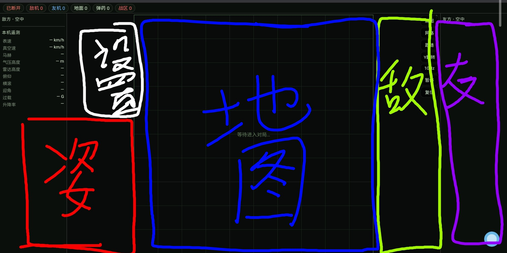
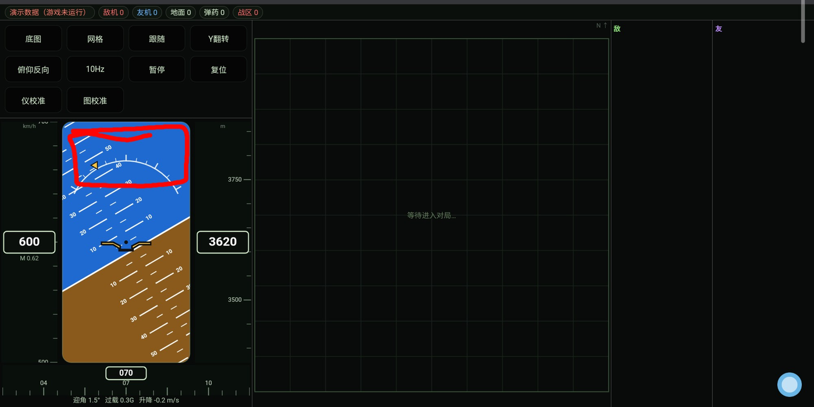
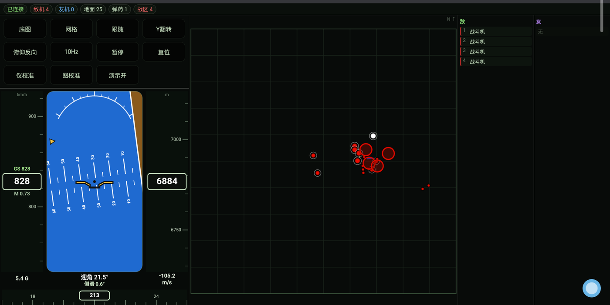
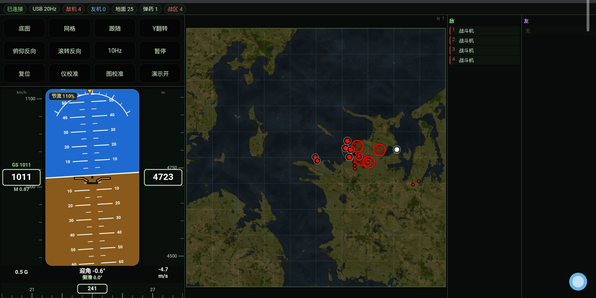

# 开发手记

> 作者：本项目的人类需求提供者 **unknown-obj**
> 说明：本文由作者手写初稿，DeepSeek V4 Flash 模型润色成文。

---

## 一、我为什么想做这个

最开始我打算用 UU 远程这类软件做一块"第三屏"，把游戏画面投到平板上。试过之后发现完全不行：

- **延迟太大**，机动的时候根本对不上；
- **画面太糊**，小字看不清；
- **只能看雷达**——可雷达我眼睛往旁边一瞥就能看到，何必再投一块屏。

那看地图呢？问题更荒谬：**我必须按 M 打开地图界面**，然后才能把这块画面投出去。
换句话说，为了看一张本来就有的图，得先在游戏里把别的界面挡起来——这多少有点脱裤子放屁。

所以只剩一条路：官方 App。但我的谷歌账号被封了，这条路也断了。

那怎么办？我盯着电脑上的 DeepSeek Harness，突然意识到：也许我可以让 AI 来把这件事做出来。

---

## 二、我是怎么提需求的——画框

写代码我不懂，游戏开发、软件开发更是零基础。但我有一支笔，和一块能截图的平板。

我的办法很土，也非常好用：**把截图存下来，用手指在图上画框，写好中文，发过去。**

第一版需求是这样表达的四块：

> 白框 = 设置；红框 = 姿态仪；蓝框 = 地图；绿框 = 敌；紫框 = 友。

后来要改姿态仪顶部的滚转刻度弧，我也是这么说的：太靠中间了，往上挪。为了讲清楚"挪到哪"，我直接把红框画在了我认为**应该**出现的位置：

框一画，歧义就没了——比描述半天"稍微往上一点"有效得多。

---

## 三、往返了二十多轮

这个项目前后**大改了三次**，沟通了**二十多轮**。

早期它只是一个能看地图的网页；后来加了遥测面板，速度、高度、马赫、俯仰、过载；再后来整个推翻重做成"左仪表右地图"的整合布局；最后补上姿态仪、航向带、断联提示、校准面板、USB 高速模式。

每一轮我都挺满意——AI 从来没让我把需求翻译成代码，我只需要说"哪里不对""应该是什么样"。它会把剩下的活干完，然后我们对着截图继续吵。

---

## 四、它最后长成什么样

进对局之后是这样的：左边姿态仪，中间战术地图，右边敌我列表。

插上数据线打开本地地址，仪表刷新率会自己切到 **20 Hz**，顶栏也会老实告诉你现在走的是哪条链路：

---

## 五、一点感想

我在这里只想说一件事：**这就是 AI 的伟大之处。**

它让一个毫无编程基础、也毫无游戏开发和软件开发知识的人，能用**可接受的成本**、**高效地**做出自己真正想要的东西。

我没有需求文档，没有原型图，没有版本管理，连"函数"两个字都说不利索。我有的只是"我觉得这里不对"的直觉，和一台能画框的平板。而这些东西，居然真的能变成一个跑在平板上、刷新率 20 Hz、姿态仪会跟着滚转指针走的工具。

那种感觉，大概就是——**第一次看到完整版的时候，震惊瘫坐，仿佛看到核弹爆炸。**

---

## 六、致谢

再次感谢 DeepSeek。

也感谢那些愿意被我反复"这不对"的时刻——没有那些来回，就没有这个项目。

更感谢的是，它让我觉得：**我似乎也拥有了无穷的力量。**

---

*本文初稿由作者手写，DeepSeek V4 Flash 模型对文字做了润色。*
*本项目全部代码亦由同一模型生成，详见 [技术文档](技术文档.md) 与 [架构说明](架构说明.md)。*

---

## 附：后记原文（未润色）

> 以下为作者最初手写的原文，一字未改，仅作对照。文中"她"指代 AI。

后记

后记

我是本项目的"人类需求提供者"

unknown-obj，我本来是准备通过UU远程之类的软件实现"第三屏"，但是使用效果完全不及预期——延迟太大，画面太糊，而且，只能看雷达，但是我明明眼睛往旁边一撇也能看啊。那看地图如何呢？那我必须点m打开界面，这个时候投射到其他设备上，那多少有点脱裤子放屁，而我的谷歌账号被封了，所以我还是用不了官方的APP。

那怎么办呢？我盯上了我电脑上的deepseek harness，也许我可以借助AI的力量来实现我的需求，显而易见的是，她实现了，而且我认为实现的非常好，至于这个东西究竟怎么样，有哪些功能，我想deepseek生成的文档里已经详细的帮我讲述了，我在这里便不再赘述。

在这里我只想说，这就是AI的伟大之处啊，能经济的让一个毫无编程基础的人毫无游戏开发和软件开发相关知识的人也能高效的经济的达到自己的需求，这个项目大改了至少3次，我和deepseek也至少沟通了20次，但是每次我都很满意，我也很享受这种"与AI斗智斗勇的感觉"。也许"震惊瘫坐，仿佛看到核弹爆炸"就是我第一次看到这个项目完整版的心情。

我从来没有想到AI的发展已经这样了——在我打开了平板的允许USB调试之后，她能当着我的面，叫出输入法，飞快的输入IP地址——连上了，我看到了态势图，流畅的姿态仪，也许在战争雷霆的战斗中并不会有太大帮助，然而这很酷，不是吗？我出于好玩的需求，让deepseek做出了这个好玩的产品，这已经是一件非常完美的事情了，但是独乐乐不如众乐乐，我想把这些分享给你们。

再次感谢deepseek，让我似乎也拥有了无限的力量。

我写的很烂，所以——感谢deepseek V4 Flash模型对本文的润色。