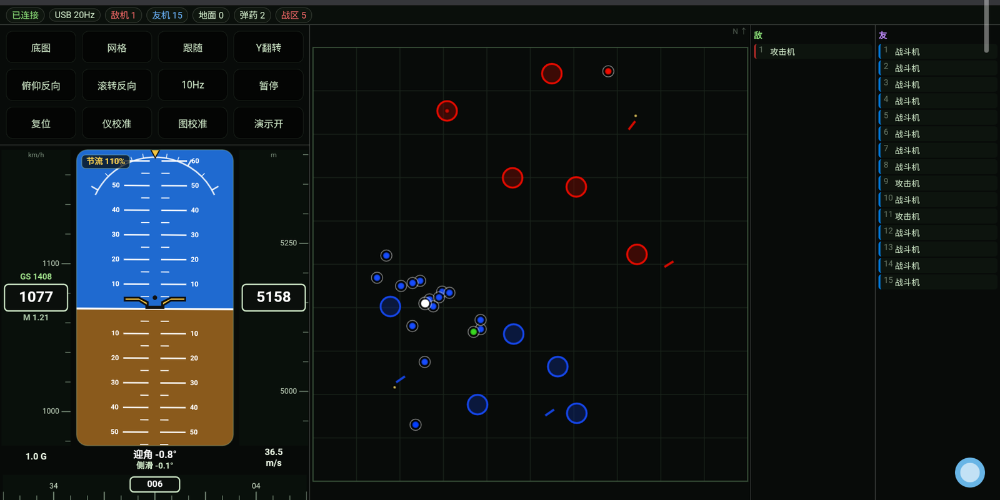
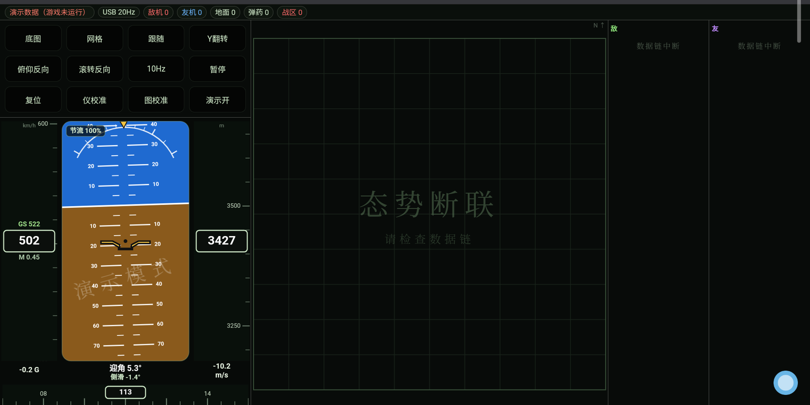
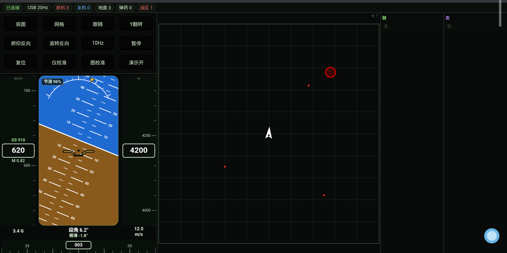
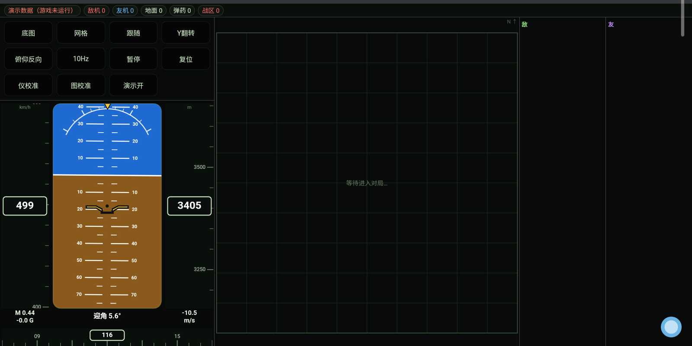

# WT 战术地图 · 技术文档

> **生成声明：本项目为 100% AI 生成项目。**
> 全部代码、脚本与本文档均由 **DeepSeek V4 Flash** 模型生成，人类仅提供需求描述与效果反馈。
> 版本 1.0 · MIT License

---

## 目录

1. [项目概述](#1-项目概述)
2. [效果预览](#2-效果预览)
3. [环境与硬件要求](#3-环境与硬件要求)
4. [数据来源：8111 接口](#4-数据来源8111-接口)
5. [部署步骤](#5-部署步骤)
6. [平板连接：两种链路](#6-平板连接两种链路)
7. [界面与操作](#7-界面与操作)
8. [刷新策略与性能](#8-刷新策略与性能)
9. [故障排查](#9-故障排查)
10. [合规边界](#10-合规边界)
11. [已知限制](#11-已知限制)
12. [二次开发](#12-二次开发)

---

## 1. 项目概述

《战争雷霆》客户端在运行时会在本机监听一个 HTTP 服务（`127.0.0.1:8111`），
返回当前战场的结构化数据。本项目把这份数据取出来，实时绘制成**平板上的第二屏**：

- **战术地图**：地形底图、敌我空中单位、地面单位、弹药点、战区圈、击落播报
- **飞行仪表**：姿态仪（地平仪 + 滚转弧 + 俯仰刻度）、表速带、高度带、航向带、节流阀、过载、迎角、侧滑、升降率

整个系统只有两个文件在干活：一个 Node 转发服务（`src/server.js`）和一个单页前端（`src/index.html`）。
没有构建步骤，没有 npm 依赖，没有数据库，没有后台进程常驻（除可选的守护脚本）。

---

## 2. 效果预览

| 主界面 | 断联提示 |
|---|---|
|  |  |

| 自身箭头（尖端 = 机头方向） | 演示模式 |
|---|---|
|  |  |

截图取自 10.6 英寸、2000×1200 的安卓平板真机。

---

## 3. 环境与硬件要求

### 3.1 硬件

| 项 | 最低配置 | 推荐 | 说明 |
|---|---|---|---|
| 电脑 | 能运行战争雷霆的 Windows PC | 任意 | 本工具本身几乎不吃性能（单进程 < 80 MB 内存） |
| 平板/手机 | 安卓 8.0+，屏幕 ≥ 8" | 10"~11"，1200p 以上 | 本项目在联想小新 Pad 2022（10.6"，2000×1200）上验证 |
| 网络 | 电脑与平板同一局域网 | 5 GHz Wi-Fi | 带宽占用约 1.2 Mbit/s |
| 数据线 | 可选，USB-C 数据线（非纯充电线） | 原装线 | 仅 USB 高速模式需要 |

> 注：设备型号仅用于说明验证环境，不包含任何设备标识。

### 3.2 软件环境

| 组件 | 版本 | 是否必需 | 说明 |
|---|---|---|---|
| Windows | 10 / 11 | 必需 | 脚本使用 PowerShell 5.1+ 与 VBScript |
| **Node.js** | **≥ 18** | **必需** | 唯一运行时依赖，只用内置模块（`http`、`fs`、`os`、`net`） |
| 浏览器 | 任意现代浏览器 | 必需 | 安卓 Chrome / Edge / 厂商内核；需支持 Canvas 2D 与 `fetch` |
| adb | platform-tools（任意近期版本） | 可选 | 仅 USB 隧道与自动化脚本使用 |
| 战争雷霆 | 任意版本 | 必需 | 需要运行中且**已进入对局** |

检查 Node 是否就绪：

```bat
node --version
```

输出版本号即可；若提示“不是内部或外部命令”，请安装后重启终端（或重启电脑让 PATH 生效）。

### 3.3 端口

| 端口 | 用途 | 说明 |
|---|---|---|
| 8111 | 游戏自带 HTTP 接口 | 只监听 `127.0.0.1`，平板访问不到 |
| 8112 | 本项目的转发服务 | 监听 `0.0.0.0`，平板通过这个端口访问 |

端口可通过环境变量修改：`set PORT=8113` 后再启动。

---

## 4. 数据来源：8111 接口

### 4.1 端点总表

| 端点 | 返回 | 本项目用途 |
|---|---|---|
| `GET /map_obj.json` | JSON 数组：所有战场对象 | 地图上的点、线、圆 |
| `GET /map_info.json` | 地图元数据（`map_min`、`map_max`、`grid_size`、`map_generation`） | 坐标换算、换图检测 |
| `GET /map.img` | JPEG 图像（约 200 KB） | 地图底图纹理 |
| `GET /state` | 自身遥测（速度、高度、姿态相关数值） | 仪表数值 |
| `GET /indicators` | 姿态角、航向、马赫等 | 姿态仪与航向带 |
| `GET /hudmsg?lastEvt=0&lastDmg=0` | 击杀/受伤事件流 | 底部播报 |

> 这些端点是客户端自带的本地服务，官方 WebUI 与官方移动端助手使用同一组接口。
> 本项目只做**只读消费**。

### 4.2 关键字段语义

**`/map_obj.json` 的每个对象**

| 字段 | 类型 | 说明 |
|---|---|---|
| `type` | string | 对象类别，如 `aircraft`、`ground_model`、`bombing_point`、`airfield` |
| `icon` | string | 图标类型，如 `Fighter`、`Bomber`、`Tank`、`Player`、`bombing_point` |
| `color` | string | 阵营色（`#rrggbb`） |
| `color[]` | array | 多段颜色（用于渐变/闪烁） |
| `blink` | number | 0/1，是否闪烁（战区被占领时闪） |
| `x` / `y` | number | 归一化坐标 0–1（有的对象用 `sx`/`sy`） |
| `dx` / `dy` | number | 单位朝向向量（用于箭头/航向） |

**`/state`**

| 字段 | 说明 |
|---|---|
| `valid` | **最重要**：`false` 时其余字段全部不可信（机库、阵亡、观战） |
| `IAS, km/h` | 表速 |
| `TAS, km/h` | 真空速 |
| `H, m` | 海拔高度 |
| `M` | 马赫 |
| `AoA, deg` | 迎角 |
| `AoS, deg` | 侧滑角 |
| `Ny` | 过载 |
| `Vy, m/s` | 升降率 |
| `throttle 1/2, %` | 油门百分比（多发动机分别给出） |

**`/indicators`**

| 字段 | 说明 |
|---|---|
| `aviahorizon_pitch` | 俯仰角（度） |
| `aviahorizon_roll` | 滚转角（度） |
| `compass` | 航向角（度，0–360，北为 0） |

### 4.3 为什么需要转发层

`8111` 只绑定回环地址（`127.0.0.1`），局域网内的平板**永远访问不到**。
因此需要一个中间人：

```
游戏进程            Node 服务              平板浏览器
:8111                :8112
127.0.0.1   <─────   0.0.0.0   <─────────  Wi-Fi / USB
```

`server.js` 做的事：

1. 收到 `/api/<name>` 请求后转发到 `127.0.0.1:8111/<name>.json`；
2. 追加 CORS 头、禁用缓存（游戏数据必须实时）；
3. 托管 `index.html` 等静态文件；
4. 上游超时/断连时返回 502，前端据此显示“断联”。

它**不解析业务字段、不缓存、不落盘**。

---

## 5. 部署步骤

### 5.1 放置与启动

1. 解压到任意目录（路径不要含中文更稳妥，但也支持中文路径）；
2. 双击 `scripts\start.cmd`：

```
  WT 战术地图
  -------------------------------------
  本机访问:   http://127.0.0.1:8112/
  平板访问:   见下方"平板可访问的地址"
```

3. 本机浏览器先开 `http://127.0.0.1:8112/` 确认界面能出来。

> 首次启动若弹出 Windows 防火墙提示，请勾选“专用网络”并允许。

### 5.2 防火墙

局域网访问被拦截时，**右键以管理员身份运行** `scripts\fix-firewall.cmd`，它会：

```
netsh advfirewall firewall add rule name="WT Tactical Map 8112" dir=in action=allow protocol=TCP localport=8112 profile=any
```

### 5.3 平板访问

控制台会打印形如：

```
平板可访问的地址：
  http://192.168.x.x:8112/   <- WLAN
```

平板浏览器打开它，建议“添加到主屏幕”，全屏后无地址栏干扰。

### 5.4 开机自启（可选）

1. `Win + R` → `shell:startup`，把 `scripts\start-hidden.vbs` 的快捷方式放进去；
2. 它会静默启动 `node src/server.js`（无控制台窗口）。

### 5.5 守护（可选，推荐）

进程被安全软件清理时，无人值守的界面会断。用任务计划程序建一个**每分钟执行**的任务：

```
程序：wscript.exe
参数："完整路径\scripts\watchdog.ps1 的静默入口.vbs"
```

> 直接调用 `powershell.exe` 会闪黑窗；建议写一个 3 行的 `.vbs`：
> ```vbs
> CreateObject("WScript.Shell").Run "powershell -NoProfile -ExecutionPolicy Bypass -File ""完整路径\scripts\watchdog.ps1""", 0, False
> ```

`watchdog.ps1` 负责两件事：

1. `supervisor.vbs` 不在就拉起（supervisor 每 2 秒检查 node，挂了 3 秒内重启）；
2. 检测到已授权的安卓设备时，重建 `adb reverse` 隧道。

---

## 6. 平板连接：两种链路

| 方式 | 平板地址 | 实际链路 | 仪表刷新 | 适用 |
|---|---|---|---|---|
| 局域网 | `http://<电脑IP>:8112/` | Wi-Fi | 10 Hz | 日常，无需插线 |
| USB 隧道 | `http://127.0.0.1:8112/` | USB 数据线 | 20 Hz | 追求更低延迟 |

页面读取 `location.hostname` 自动判断，顶栏显示 `USB 20Hz` 或 `WiFi 10Hz`。

### 6.1 USB 模式设置

1. 平板：设置 → 关于 → 连点版本号 7 次，开启开发者选项 → 打开 **USB 调试**；
2. 数据线连接电脑，平板弹窗点“允许”（可勾选“始终允许”）；
3. 电脑执行：

```bat
adb devices
adb reverse tcp:8112 tcp:8112
```

4. 平板打开 `http://127.0.0.1:8112/`。

> 拔线后 `127.0.0.1` 会失效，换回局域网地址即可。
> 建议在平板存两个书签，按是否插线切换。

---

## 7. 界面与操作

```
┌────────────────────────────────────────────────────────────────────┐
│ 状态 │ 链路 │ 敌机 │ 友机 │ 地面 │ 弹药 │ 战区                     │
├──────────────┬───────────────────────────────┬─────────────────────┤
│ 设置按钮 ×11 │           战术地图            │  敌         友      │
│ 姿态仪       │ （地形/单位/战区/弹药/播报）  │ （列表）  （列表）  │
└──────────────┴───────────────────────────────┴─────────────────────┘
```

### 7.1 姿态仪

- **顶部**：滚转刻度弧（固定）+ 黄色指针（随坡度转）+ 节流阀百分比
- **中部**：天地线（俯仰上下、滚转旋转）、俯仰刻度（±60° 满量程，画到 ±85°）、固定飞机符号
- **底部**：航向带（每 30° 两位数字，N/E/S/W）
- **左右**：表速带（框内表速，上方地速，下方马赫）、高度带
- **最下读数**：过载 │ 迎角 + 侧滑 │ 升降率

### 7.2 地图

| 元素 | 含义 |
|---|---|
| 白箭头 | 自己（尖端为机头方向，绕**质心**旋转） |
| 红/蓝点 | 敌/友空中单位 |
| 小点 | 地面单位 |
| 黄点 | 弹药点 |
| 红/蓝圆环 | 战区（被占领时闪烁） |
| 底部文字 | 击落播报（最近 5 条） |

### 7.3 按钮

| 按钮 | 作用 |
|---|---|
| 底图 / 网格 | 显示或隐藏底图、网格 |
| 跟随 | 视图锁定自己（保持缩放） |
| Y翻转 | 地图南北翻转 |
| 俯仰反向 / 滚转反向 | 姿态轴独立取反（不同版本符号可能不同） |
| 10Hz / 12Hz / 5Hz | 轮询频率档位 |
| 暂停 | 完全停止请求 |
| 复位 | 视图归位 |
| 仪校准 | 俯仰/滚转零点微调、单位切换（度/弧度） |
| 图校准 | 地图标记整体平移 |
| 演示开/关 | 无数据时是否播放合成动画 |

校准值保存在浏览器 `localStorage`，刷新不丢。

### 7.4 状态提示

| 条件 | 表现 |
|---|---|
| 正常对局 | 状态“已连接”，仪表实时 |
| 无数据/未进对局/服务断开 | 地图中央宋体「态势断联 / 请检查数据链」，敌我栏「数据链中断」 |
| 对局中但阵亡/观战 | 仪表归零，状态「观战中」 |
| 演示模式运行 | 姿态仪叠加半透明「演示模式」水印 |

---

## 8. 刷新策略与性能

### 8.1 轮询频率

| 接口 | USB | Wi-Fi | 单次体积 |
|---|---|---|---|
| `map_obj.json` | 10 Hz | 10 Hz | 10–20 KB |
| `state` | 20 Hz | 10 Hz | < 1 KB |
| `indicators` | 20 Hz | 10 Hz | 1–2 KB |
| `hudmsg` | 0.5 Hz | 0.5 Hz | 10–30 KB |
| `map_info.json` | 0.125 Hz | 0.125 Hz | < 1 KB |

合计约 **1.2–1.4 Mbit/s**，占 260 Mbit/s Wi-Fi 的 0.5%。

### 8.2 平滑

数据离散到达（50–100 ms 一次），屏幕 60 fps，直接跳会看到“指针一格一格蹦”。
前端对姿态、表速、高度做**指数平滑**：

```js
const k = 1 - Math.exp(-dt / 0.035);   // τ = 35 ms
value += (target - value) * k;
```

代价是约 35 ms 视觉延迟，换来连续运动。拖影/过冲不会出现（一阶滤波无过冲）。

### 8.3 分级渲染

- **姿态仪**：每帧（60 fps）重绘，保证顺滑
- **地图**：约 11 Hz 重绘，静态内容不必占用 60 fps 的 CPU

在地板级平板上，这一条能把掉帧从“明显”降到“无感”。

### 8.4 为什么不让游戏端加压

`8111` 由游戏主进程内的 HTTP 线程提供，请求过密会影响游戏。
本项目把总请求压在 **30–50 次/秒**，且大部分是几百字节的小响应；
压力测试中未观察到游戏帧率变化。

---

## 9. 故障排查

| 现象 | 可能原因 | 处理 |
|---|---|---|
| 平板打不开页面 | 电脑 IP 变了 / 防火墙拦截 / 服务没起 | 看控制台打印的新地址；运行 `fix-firewall.cmd`；确认 `node` 进程存在 |
| 页面打开但一直“已断开” | 游戏没开 / 没进对局 / 接口被占 | 进对局；确认 `http://127.0.0.1:8111/` 能打开 |
| 数值全 0 且状态“观战中” | 当前没有载具（阵亡/观战/重生界面） | 正常现象，重生后恢复 |
| 机库里有奇怪数值 | 上一局的残留（`valid=false`） | 已做无效化，不需要处理 |
| USB 模式打不开 | `adb reverse` 断了 / USB 调试关闭 | 重插线，重新执行 `adb reverse tcp:8112 tcp:8112` |
| `adb devices` 为空 | 线只供电 / 未授权 / 驱动异常 | 换线；平板重新点“允许”；重装驱动 |
| 姿态方向反了 | 不同版本字段符号不同 | 用「俯仰反向 / 滚转反向」+「仪校准」调 |
| 端口被占用 | 启动了多个实例 | `stop.cmd` 后只保留一个 |
| 中文乱码（脚本） | PowerShell 5.1 读取无 BOM 的 UTF-8 | 仓库内脚本均已带 BOM |

日志：

| 文件 | 内容 |
|---|---|
| `watchdog.log` | 守护动作（守护脚本同目录） |
| 控制台输出 | 服务启动信息、上游错误 |

---

## 10. 合规边界

### 10.1 依据

《战争雷霆》服务条款（EULA）相关条目：

- **3.2.8**：不得使用未经授权的第三方程序进行“未经授权的连接”；
- **3.2.9**：**不得挖掘或收集正常游戏中不会显示的数据**。

### 10.2 红线对照

| 行为 | 判定 |
|---|---|
| 显示小地图上已有的敌我单位、战区、占点 | ✅ 安全 |
| 显示 TAB / 聊天框可见的击落播报 | ✅ 安全 |
| 显示自身遥测（速度、高度、姿态） | ✅ 安全 |
| 显示**未点亮**的敌人 | ❌ 违规（3.2.9） |
| 计算敌我**距离/速度**、做提前量 | ❌ 违规（3.2.9） |
| 全真（SB）等无标记模式下显示敌人 | ❌ 违规 |
| 叠加到游戏画面、自动化操作 | ❌ 违规（3.2.3） |

### 10.3 本项目刻意未实现的功能

距离计算、速度推算、未点亮目标、自动瞄准、任何形式的自动化。

**开源不等于免责**：请在你所在赛区/赛事规则允许的范围内使用。

---

## 11. 已知限制

| 项 | 说明 |
|---|---|
| 玩家名单 | 接口不提供花名册，名字只出现在击落播报 |
| 战区血量 | `bombing_point` 无 `health` 字段，只能显示存在/消失 |
| 具体型号 | `icon` 只给机种，型号仅在播报文本里 |
| 地速 | 无独立字段；游戏无风场，地速恒等于真空速 |
| 雷达高度 | 未暴露 |
| 机库数据 | `valid=false`，已做无效化 |
| 帧率 | 取决于平板性能；低端机建议开 5Hz |

---

## 12. 二次开发

| 想做什么 | 改哪里 |
|---|---|
| 改端口 | `src/server.js` 顶部 `PORT`，或环境变量 `PORT` |
| 改上游地址 | 环境变量 `WT_API_BASE`（默认 `http://127.0.0.1:8111`） |
| 加一个仪表 | `src/index.html` 的 `drawPFD()`：取值 → 绘制 |
| 改地图图标 | `drawMap()` 里 `kindOf()` 与对应分支 |
| 改刷新频率 | `pollMs`（地图）、`instMs`（仪表） |
| 换配色 | `<style>` 的 CSS 变量与 canvas 的 `fillStyle` |
| 加新数据源 | `server.js` 里加一条转发路由即可 |

前端无构建、无框架，改完刷新页面生效。

---

## 附：本项目为 AI 生成

再次说明：**本仓库全部代码、脚本与文档由 DeepSeek V4 Flash 模型生成**，
人类提供需求、描述现象、验证结果。任何“作者经验”类描述均不适用于本项目。
